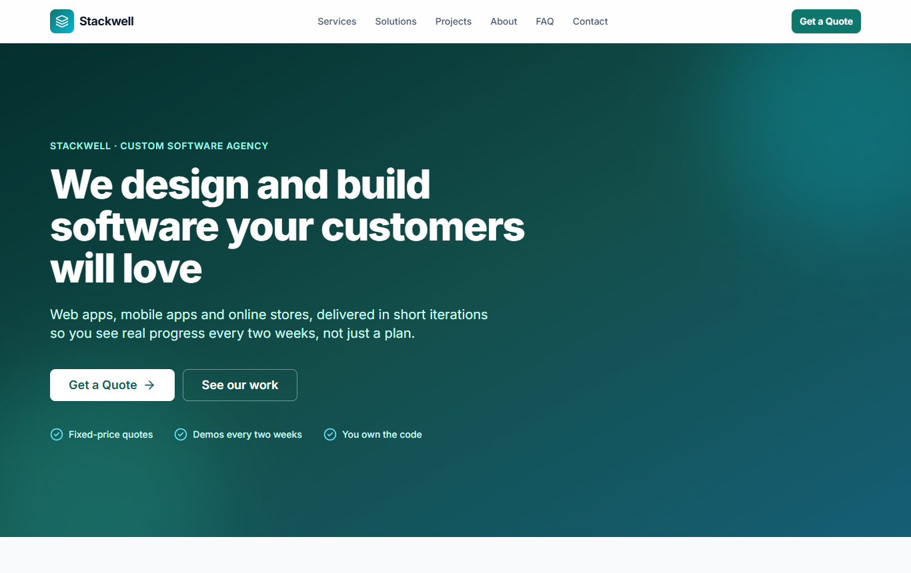
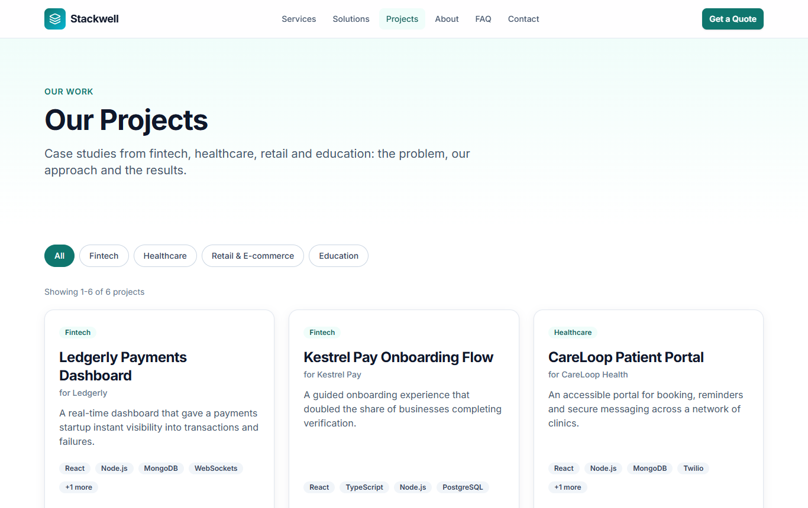
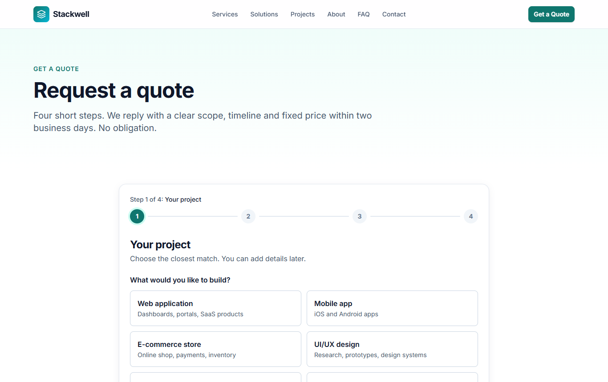
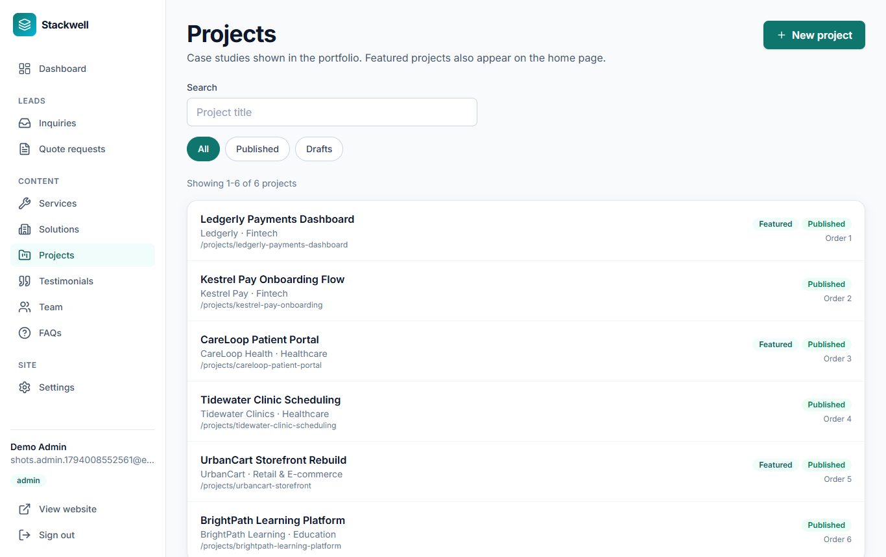

# Stackwell Agency Platform

[](https://github.com/sabatauqeer656/stackwell-agency-platform/actions/workflows/ci.yml)

A full-stack MERN website for a (fictional) software agency: a marketing site that turns visitors into leads, and an admin dashboard for managing those leads and the site's content.

**Live demo:** https://stackwell-agency-platform.onrender.com (hosted on Render's free plan, so the first visit after a quiet period can take about 30 seconds while the server wakes up). The admin dashboard is at `/admin`; its login is private.

> **Status:** the REST API, the public site and the admin dashboard are finished (Phases 1 to 5). Phase 6 (polish) is complete. See the [Roadmap](#roadmap).
> The agency, clients, team and figures are invented for this portfolio project.

## Highlights

- **Full stack, shipped:** React 19 + Vite + Tailwind v4 on the front, Express 5 + MongoDB (Atlas) + Cloudinary on the back, deployed as one Render web service that serves both the site and the API.
- **Real authentication:** bcrypt, short-lived access tokens in memory, rotating refresh tokens in `httpOnly` cookies, server-side revocation, rate-limited login, and role-based access (`admin` / `editor`) enforced by the API, not just the UI.
- **Careful file handling:** uploads are verified by their actual content (not the file name), size-limited, stored privately (quote attachments, opened only through expiring signed links) or publicly (website images), and cleaned up when no longer used.
- **A complete admin dashboard:** lead pipeline, six content editors, image uploads and site settings. The editors share one configurable data layer and one form hook, so adding a content type is mostly configuration.
- **Built to be reliable:** every list and form handles loading, error and empty states; unsaved changes are guarded; edits show on the public site without a reload; and everything works at phone width.
- **Tested and checked on every push:** 144 automated tests (API and client) plus lint and a production build run in GitHub Actions, and each feature was also verified end to end in Chrome against the real services, including failure cases such as fake file types, oversized files and blocked roles.
- **Accessible and discoverable:** keyboard and screen-reader support, per-page SEO, structured data and `robots.txt`.

## Screenshots

| Home | Projects |
| --- | --- |
|  |  |

| Quote wizard | Admin dashboard (projects) |
| --- | --- |
|  |  |

The site is fully responsive, for example on a phone: [home page](docs/screenshots/home-mobile.png).

## What it does

**Public site**
- Home, Services, Solutions (industries), Projects (case studies with an industry filter and pagination), About (with the team), FAQ and Contact pages, all loaded from the API.
- A **contact form** and a **four-step quote wizard** with per-step validation, saved drafts, `?service=` pre-selection and **file attachments** (PDF, PNG, JPG, DOCX).
- Per-page SEO: titles, descriptions, canonical URLs, Open Graph tags, structured data (JSON-LD), `robots.txt`.
- Accessible by design: skip link, landmarks, keyboard-operable controls, focus management on page changes, screen-reader announcements, `prefers-reduced-motion` support.

**Admin dashboard** (`/admin`, for `admin` and `editor` accounts)
- **Home:** live numbers (new inquiries, quote pipeline, published and draft content) and the latest leads.
- **Leads:** an inquiries inbox and a quote-request pipeline (new, reviewing, proposal sent, won, lost) with search, status filters, pagination, internal notes and private attachment downloads. Filters live in the URL, so any view can be bookmarked.
- **Content editors** for services, solutions, projects, testimonials, team members and FAQs: drafts, ordering, lists of points, a unique web address per page, and a confirmation before anything is deleted. Changes appear on the public site immediately, without a reload.
- **Image uploads** for team photos, testimonial photos and project covers and galleries, checked by their real content, resized, stored publicly on Cloudinary, and removed again when replaced or deleted.
- **Site settings** (admin only): company details, contact information, social links and footer text.
- **Roles and safety:** editors cannot delete or open settings (the screens hide them and the API refuses them anyway), leaving a form with unsaved changes asks first, and the whole dashboard works on a phone.

**API and lead handling**
- JWT authentication with short-lived access tokens, a rotating refresh token in an `httpOnly` cookie, and `admin` / `editor` roles.
- CRUD for services, solutions, projects, testimonials, team members, FAQs and site settings, each with a public (published only) and an admin side.
- Inquiries and quote requests with a status pipeline, spam protection (rate limit, honeypot, strict validation), **private file storage** with short-lived signed download links, and **email notifications** to the team plus a confirmation to the visitor.

## Tech stack

| Layer | Technology |
| --- | --- |
| Frontend | React 19, Vite, Tailwind CSS v4, React Router v7, TanStack Query, Axios, React Hook Form + Zod, Framer Motion, react-helmet-async, lucide-react |
| Backend | Node.js (ESM), Express 5, Mongoose, Zod, JWT, bcrypt, helmet, cors, express-rate-limit, multer, file-type, Nodemailer, morgan |
| Services | MongoDB Atlas (database), Cloudinary (private file storage), SMTP (email, optional) |

## Prerequisites

- **Node.js** `^20.19.0` or `>=22.12.0`
- A **MongoDB** database. A free [MongoDB Atlas](https://www.mongodb.com/cloud/atlas) cluster works.
- A free [Cloudinary](https://cloudinary.com) account (quote attachments and website images).

## Getting started

```bash
# 1. Install dependencies for both apps (npm workspaces)
npm install

# 2. Configure the server
cp server/.env.example server/.env
#    then edit server/.env: set MONGO_URI, the three CLOUDINARY_* values, and generate the two JWT secrets with
#    node -e "console.log(require('crypto').randomBytes(48).toString('hex'))"

# 3. Add demo content (services, projects, FAQs...) and your admin account
npm run seed
#    for the admin: set ADMIN_NAME, ADMIN_EMAIL and ADMIN_PASSWORD in server/.env, then
npm run seed:admin

# 4. Run the client and the API together
npm run dev
```

- Client: http://localhost:5173
- API health check: http://localhost:5000/api/v1/health

The client's `client/.env.example` is optional. Copy it to `client/.env` only if the API runs somewhere other than `http://localhost:5000/api/v1`.

## Environment variables

Server (`server/.env`), validated with Zod at startup. The server refuses to start if a required value is missing or invalid.

| Variable | Required | Default | Description |
| --- | --- | --- | --- |
| `NODE_ENV` | no | `development` | `development`, `production` or `test`. In `production` the server also serves the built React app and trusts one proxy |
| `PORT` | no | `5000` | Port the API listens on (hosting platforms set this themselves) |
| `CLIENT_URL` | yes | | Address of the site, used for the CORS allowlist. In production it is the site's own `https://` address |
| `MONGO_URI` | yes | | MongoDB connection string (contains credentials, never commit it). Include a database name, e.g. `.../stackwell?...` |
| `JWT_ACCESS_SECRET` | yes | | Signs short-lived access tokens (min 32 characters) |
| `JWT_ACCESS_EXPIRES_IN` | no | `15m` | Access token lifetime |
| `JWT_REFRESH_SECRET` | yes | | Signs refresh tokens (min 32 characters, different from the access secret) |
| `JWT_REFRESH_EXPIRES_DAYS` | no | `7` | Refresh token lifetime in days |
| `CLOUDINARY_CLOUD_NAME`, `CLOUDINARY_API_KEY`, `CLOUDINARY_API_SECRET` | yes | | File storage. Quote attachments are stored privately and opened only through short-lived signed links; website images (team, projects, testimonials) are stored publicly. The secret is a password, never commit it |
| `SMTP_HOST`, `SMTP_USER`, `SMTP_PASS`, `MAIL_FROM` | no | | Enables real email (set all four or none). Without them, notification emails are composed and logged instead of sent. For Gmail use an [App Password](https://myaccount.google.com/apppasswords) |
| `SMTP_PORT` | no | `465` | `465` (SSL) or `587` (STARTTLS) |
| `MAIL_TO` | no | `SMTP_USER` | Inbox that receives "new message" and "new quote request" alerts |
| `ADMIN_NAME`, `ADMIN_EMAIL`, `ADMIN_PASSWORD` | no | | Only read by `npm run seed:admin`. Remove the password afterwards |

Client (`client/.env`, optional): `VITE_API_URL` is the API base URL (it defaults to `http://localhost:5000/api/v1` in development and to the relative `/api/v1` in production, where the same server serves both), and `VITE_SITE_URL` is the deployed address used for canonical links. Variables prefixed `VITE_` are public; never put secrets in them.

## Scripts

Run from the project root.

| Command | What it does |
| --- | --- |
| `npm run dev` | Starts the client (Vite) and the server (`node --watch`) together |
| `npm run build` | Builds the client for production into `client/dist` |
| `npm start` | Starts the server without file watching (production) |
| `npm run lint` | Lints the client |
| `npm test` | Runs the API tests and the client tests (see [Testing](#testing)) |
| `npm test -w server` / `npm test -w client` | Runs only one of the two suites |
| `npm run seed` | Adds demo content that is missing. Safe to run again: existing content is never overwritten |
| `npm run seed -- --reset --yes` | Deletes all site content, then re-adds the demo content. Users, inquiries and quote requests are never touched |
| `npm run seed:admin` | Creates the first admin account from the `ADMIN_*` values in `server/.env` |

## API overview

Base path `/api/v1`. Every response is `{ success, data, meta? }` or `{ success: false, error: { message, code, details? } }`. On an admin update (`PATCH`), sending an optional field as `null` removes it.

| Area | Public | Admin or editor (delete: admin only) |
| --- | --- | --- |
| Auth | `POST /auth/login`, `POST /auth/refresh`, `POST /auth/logout`, `GET /auth/me` (needs a token) | |
| Services, Solutions | `GET /services`, `/services/:slug`, `/solutions`, `/solutions/:slug` | `/admin/services`, `/admin/solutions`: list, get, create, update, delete |
| Projects | `GET /projects` (`?industry=`, `?featured=`, `?page=`, `?limit=`), `/projects/:slug` | `/admin/projects` |
| Testimonials, Team, FAQs | `GET /testimonials`, `/team`, `/faqs` (`?category=`) | `/admin/testimonials`, `/admin/team`, `/admin/faqs` |
| Settings | `GET /settings` | `PATCH /admin/settings` (admin only) |
| Images | | `POST /admin/uploads/images` (`multipart/form-data`, one PNG, JPG or WebP up to 5 MB, answers with its public address) |
| Inquiries | `POST /inquiries` | `/admin/inquiries`: list, get, update status and notes, delete |
| Quote requests | `POST /quotes` (JSON, or `multipart/form-data` with up to 3 attachments) | `/admin/quotes`: list, get, update status and notes, delete, `GET /admin/quotes/:id/attachments/:index/download` (signed link, 5 minutes) |

## Security highlights

- Passwords hashed with bcrypt (cost 12). Login errors are generic and take the same time whether or not the email exists.
- Access token in memory, refresh token in an `httpOnly` cookie. A `tokenVersion` lets a logout revoke every token of a user at once.
- Every input is validated with Zod on the server (unknown fields are dropped), and every route group is guarded in one place.
- Public form endpoints are rate limited and have a honeypot field. Quote attachments are checked by their **actual content** (not their name), stored **privately**, and only reachable through expiring signed links.
- Uploaded images are checked by their **actual content** (SVG is refused because it can hide scripts), limited to 5 MB, shrunk to at most 1600 px and given random names. Images that are replaced or deleted are removed from Cloudinary, and only files in our own folder are ever deleted.
- Roles are enforced on the server for every admin route group, not just hidden in the screens.
- Emails are protected against header injection and HTML injection, and the visitor confirmation never repeats visitor-supplied text.
- Secrets live only in `server/.env` (git-ignored) and are validated at startup. `helmet` sets security headers and CORS allows only the client origin.

## Project structure

```
agency-website/
├─ client/                 React app
│  ├─ public/              favicon, robots.txt
│  └─ src/
│     ├─ app/              router (lazy-loaded pages) and providers
│     ├─ components/
│     │  ├─ ui/            Button, Input, Card, Modal, Toast, QueryState, ...
│     │  ├─ layout/        Navbar, Footer, PublicLayout, Section, PageHeader, ...
│     │  ├─ sections/      page sections (Hero, ServicesSection, ProjectCard, ...)
│     │  ├─ forms/         ContactForm, QuoteWizard, FileDropzone, step screens
│     │  └─ admin/         dashboard layout, shared lists and editors, image fields, guards
│     ├─ features/         data hooks and form rules per domain (services, quotes, ...)
│     │  └─ admin/         content API factory, record editor hook, form rules per editor
│     ├─ lib/              axios instance, query client, API error helpers
│     └─ pages/
│        ├─ public/        the public website
│        └─ admin/         dashboard screens (login, lists and editors)
├─ server/                 Express API
│  └─ src/
│     ├─ config/           env.js (Zod-validated), db.js, cloudinary.js
│     ├─ models/           Mongoose models
│     ├─ routes/           public routes, and routes/admin/ (guarded as a group)
│     ├─ controllers/      thin request handlers
│     ├─ services/         business logic, storage, email, notifications
│     ├─ middleware/       auth, validation, uploads, rate limits, honeypot, errors
│     ├─ validators/       Zod schemas
│     ├─ seed/             demo content and admin creation
│     ├─ app.js            Express app: middleware and routes
│     └─ server.js         connects to MongoDB, then starts listening
└─ package.json            npm workspaces and root scripts
```

## Architecture notes

- **Monorepo with npm workspaces:** one install, one lockfile; the client and API still deploy separately.
- **Layers on the server:** route, validate, controller, service, model. Controllers stay thin and the logic lives in services.
- **Configuration:** the server reads settings only through the validated `env` object in `server/src/config/env.js`.
- **Server state on the client:** TanStack Query for everything that comes from the API (loading, error, empty and success states are handled in one shared component). Filters and pages live in the URL, so views are shareable.
- **Design system:** colors, type scale, radii and shadows are Tailwind tokens defined once in `client/src/index.css`.
- **Performance:** every page except the home page is code-split and downloaded on demand (including the whole admin dashboard, which public visitors never download); the animation engine loads after first paint.
- **Admin screens share their logic:** one factory (`createContentApi`) provides the list, open, create, update and delete hooks for every content type and refreshes the public site's cached data after each change. One hook (`useRecordEditor`) and one frame component (`EditorFrame`) carry the shared behaviour of the add/edit forms: validation, saving, the unsaved-changes guard and delete confirmation. A new content type is mostly configuration.
- **One server, one address in production:** Express serves the built React app and the API together, so there are no cross-site cookies or CORS problems, and one deploy ships everything.

## Deployment

The live demo runs on [Render](https://render.com) as a single **Web Service** (the free plan is enough), with the database on MongoDB Atlas and files on Cloudinary.

1. Create a Web Service from this repository, branch `main`, runtime Node, empty root directory.
2. **Build command:** `npm ci --include=dev && npm run build` (`--include=dev` is needed because the build tools are dev dependencies and Render sets `NODE_ENV=production`).
3. **Start command:** `npm start`. **Health check path:** `/api/v1/health`.
4. Set the environment variables from the table above in Render's dashboard: `NODE_ENV=production`, `CLIENT_URL` (the service's own `https://` address), `MONGO_URI`, both `JWT_*` secrets and the three `CLOUDINARY_*` values. Do not set `PORT`.
5. In MongoDB Atlas, under **Network Access**, allow Render to connect. Render's free plan has no fixed address, so this means `0.0.0.0/0` (the database password still protects it).
6. Create the first admin account once with `npm run seed:admin` (run locally against the same database, with the `ADMIN_*` values in `server/.env`).

Pushing to `main` redeploys automatically.

## Testing

`npm test` runs two suites, and **GitHub Actions runs them (plus lint and a production build) on every push** (see `.github/workflows/ci.yml`).

**API tests** (`server/test`, Node's built-in test runner, 76 tests). They start the real Express app against a throwaway MongoDB, so they never touch your own database, Cloudinary account or mail server:
- **Authentication:** login (the same answer for a wrong password and an unknown email), httpOnly refresh cookie, session renewal, logout revoking every token, deactivated users, and login rate limiting.
- **Authorization:** every admin route refuses visitors who are not signed in; editors cannot delete or change settings; drafts never leak to the public API.
- **Content:** services, solutions, projects, team, testimonials, FAQs and settings (validation, unique web addresses, draft visibility, pagination, blocked deletes, "send null to remove a field").
- **Leads:** the contact form and quote wizard (honeypot, rate limit, a visitor cannot set a status), notification emails (HTML and header injection), and attachment and image upload rejection (fake file types, too many or too large files).
- **Unit tests** of the small pure helpers and validation rules.

The first run downloads a MongoDB binary (about 700 MB, then cached). Set `MONGO_TEST_URI=mongodb://127.0.0.1:27017` to use a MongoDB you already run instead.

**Client tests** (`client/src/**/*.test.*`, Vitest and Testing Library, 68 tests): form rules for every editor and public form, helpers, accessible labelling and states of the UI components (fields, buttons, pagination, dialogs), and the contact form end to end against a fake server (validation, double-submit guard, server and network errors).

**Also checked by hand** during development with real-browser (Chrome) runs against the real services: uploads to Cloudinary, cache refreshes after edits, unsaved-changes guards, phone-width layouts, and an `axe-core` accessibility scan of every public page, admin screen and interactive state.

## Roadmap

- [x] **Phase 1: Foundation.** Monorepo, Express skeleton, env validation, MongoDB connection, error handling, security middleware, design system and UI kit.
- [x] **Phase 2: Backend core.** Models, validators, public and admin CRUD, JWT auth with refresh tokens and roles, seed data.
- [x] **Phase 3: Public site.** Navbar, footer, all public pages wired to the API, animations, SEO, code splitting.
- [x] **Phase 4: Lead capture.** Contact form, quote wizard, file uploads, email notifications.
- [x] **Phase 5: Admin dashboard.** Login, lead pipeline, content management, image uploads, settings.
- [x] **Deployed** to Render (single web service).
- [x] **Accessibility audit** (axe-core and keyboard checks) and **automated tests with CI.**
- [x] **Phase 6: Polish.** Accessibility audit, automated tests with CI, live sitemap and robots, screenshots, clean-up of the temporary pages.
